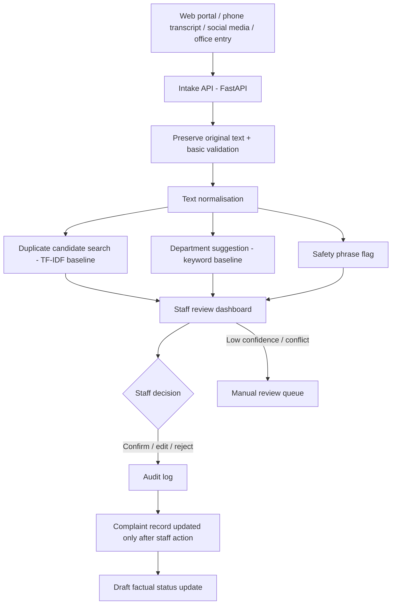

# Architecture and data flow

## Trust boundary
The model returns suggestions only. A staff member must confirm a routing or duplicate action. The prototype uses in-memory storage and synthetic data; PostgreSQL, authentication, and live integrations are future work.
